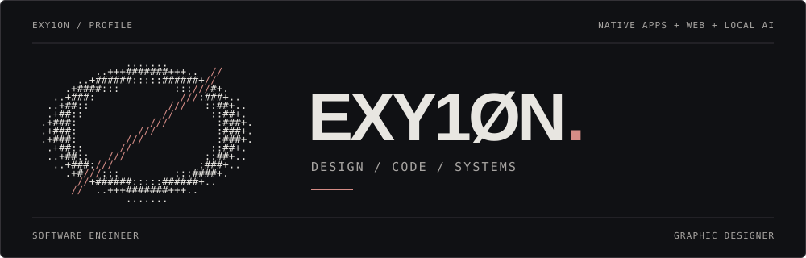

<picture>
  <source media="(prefers-color-scheme: dark)" srcset="assets/header-dark.svg">
  <source media="(prefers-color-scheme: light)" srcset="assets/header-light.svg">
  
</picture>

# EXY1ØN

**Privacy-focused software engineer & graphic designer.**

I build native apps and websites with privacy and user control considered from the first design decision. I bring visual design and systems thinking together to make software that is clear to use, efficient to run and practical to maintain.

`Native apps` · `Web` · `Privacy` · `Local AI`

## Selected work

### [ApexFire](https://github.com/EXY1ON/apexfire)

**Fire tracking and historical fire evidence for North Macedonia.**

A research prototype that brings satellite heat detections, weather and a historical fire archive into one interactive map. Built for the NASA Space Apps Challenge 2026.

`TypeScript` · `React` · `MapLibre` · `Python` · `Firebase`

[Explore the prototype](https://apexfire.web.app) · [Read the source](https://github.com/EXY1ON/apexfire)

*Satellite detections are not confirmed fires. Experimental spread scenarios are not forecasts.*

## On my workbench

- **Native iOS** — Swift and SwiftUI, with a focus on polished, local-first experiences.
- **Web** — Responsive interfaces and practical websites for small businesses.
- **Design** — Brand identity and interface design. 
- **Local AI** — Exploring local models with llama.cpp and Open WebUI, alongside self-hosted workflows that keep data under my control.

### AI Council

I organize AI-assisted development through a personal AI Council, with defined responsibilities:

- **Claude** — Implementation, refactoring, debugging and UI development.
- **Codex** — Architecture, strategy, research, and independent code, security and privacy review.

I set the direction: define the problem, establish constraints and acceptance criteria, plan the roadmap and review the result. Project records, architecture decisions and explicit handoffs carry context between tools. I validate generated work against source code, tests and primary documentation, and take responsibility for the decisions.

## How I build

I hold every task and project to my **Gold standard**: correct behavior, clear design, accessibility, security, privacy, maintainability and evidence that the result works. I scale the planning and verification to the consequences of the work.

- **Give the work structure.** Start with a clear brief, understand the existing system, record consequential decisions and turn the roadmap into small steps with measurable acceptance criteria.
- **Design privacy into the system.** Understand where data goes, minimize collection and telemetry, and prefer local processing where practical. Evaluate external services for their data access, dependencies and exit costs; preserve open formats, exports and migration paths.
- **Make craft part of the implementation.** Build accessible interfaces, respect native behavior, write readable code and choose dependencies for a concrete need. Treat usability, security and maintainability as requirements.
- **Deliver in reviewable increments.** Make the smallest complete change, preserve working behavior and plan recovery for changes that put data or essential journeys at risk.
- **Finish with evidence.** Review code, check current documentation and verify important behavior and failure cases. Leave useful run instructions, explicit limitations and a handoff someone else can act on.

---

North Macedonia · [Public repositories](https://github.com/EXY1ON?tab=repositories)
